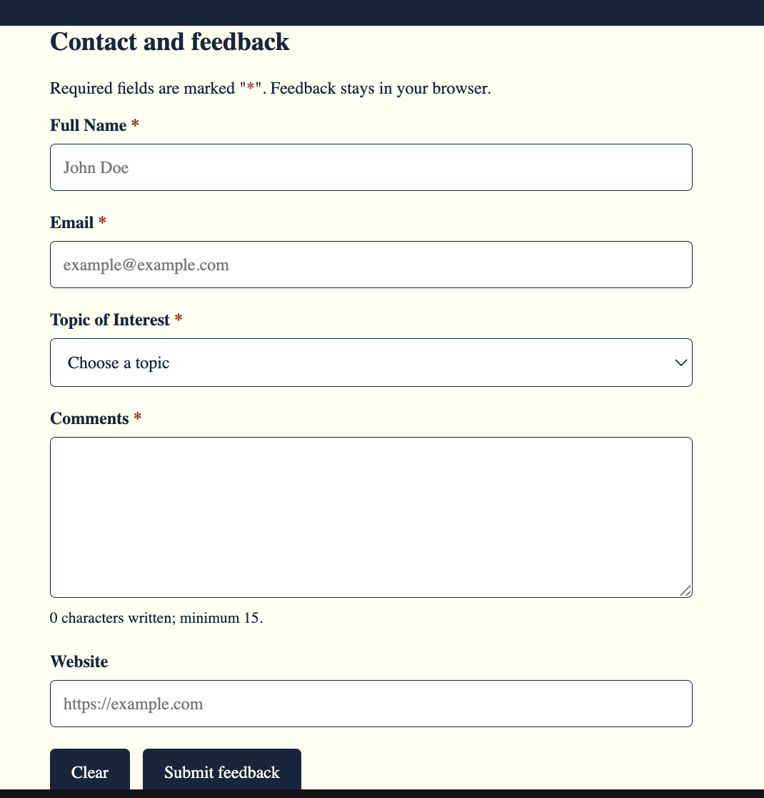
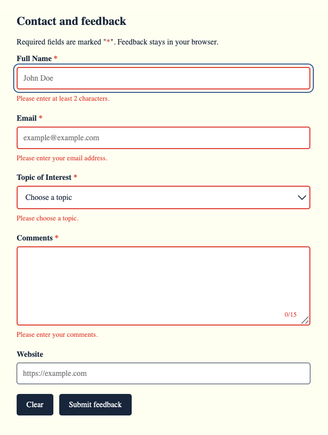
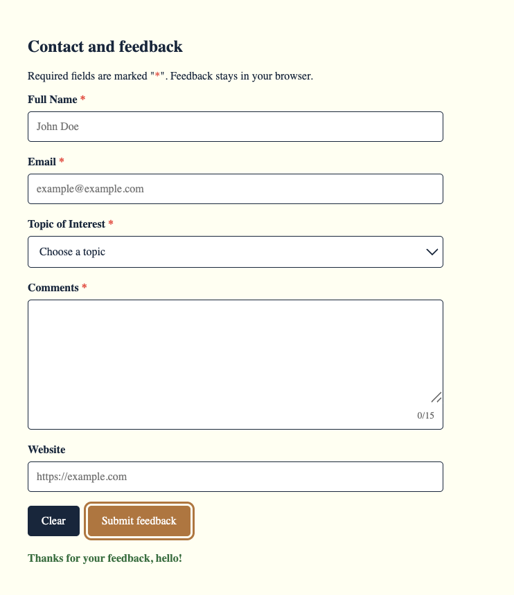
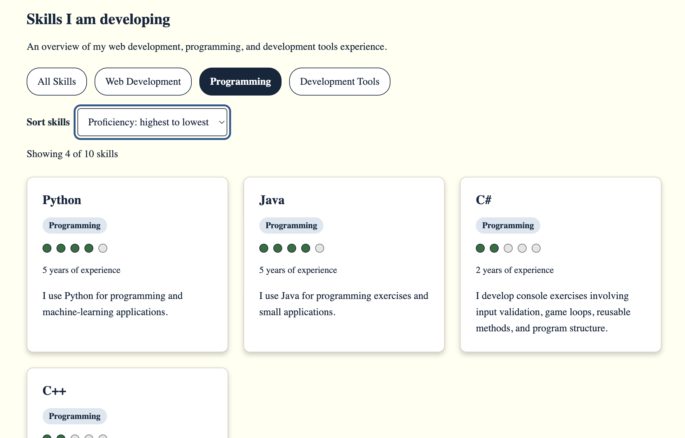
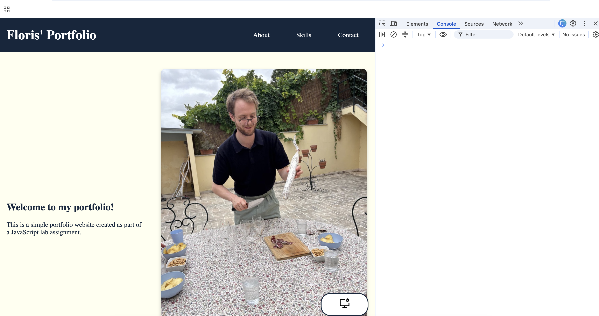
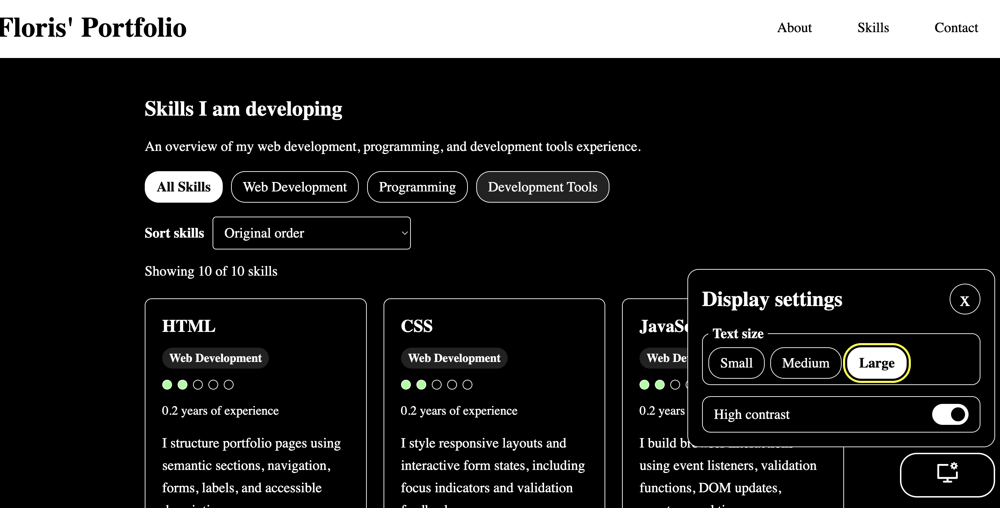

# Lab 2 Interactive Portfolio Report

Floris van der Staaij | DA558A | Target Grade 5

Student ID: flvaa003

Repository: https://github.com/Fvdstaay/Javascript

Report date: 2 November 2026

## Project information

I extended my Lab 1 portfolio with three vanilla JavaScript features: an accessible feedback form, a data-driven skills showcase, and persistent text-size and contrast controls. The project uses external scripts and local images without a backend or build step. Opening `code/home.html` runs the site. Feedback is not stored or sent; only display preferences are saved locally.

## Feedback form

The Contact section contains required Full Name, Email, Topic, and Comments fields and an optional Website field. Visible labels identify each control. `aria-describedby` connects controls to their error messages and connects Comments to its guidance and counter. A status area announces success. CSS distinguishes neutral, focus, invalid, and valid states, with written errors so color is not the only feedback.

In `code/feedback.js`, field references are cached and focused validators return booleans. Names allow international letters, combining marks, spaces, apostrophes, and hyphens. Email and Website checks use browser validity properties; an empty Website remains neutral. Text fields validate on blur and recheck after editing a previously validated value. Topic validates on change and blur.

Comments validate on input and blur. The input handler calls `updateCommentsCounter()` and `validateComments()`. Both use `countCommentCharacters()` to count Unicode code points excluding whitespace, with a minimum of 15. Red and green counter feedback communicates whether that minimum is reached. The counter continues beyond 15.

`showFieldError()` updates classes, written text, and `aria-invalid`. The corresponding clearing, valid-state, and reset helpers keep presentation separate from validation. `handleSubmit()` prevents navigation, runs every validator, and focuses the first invalid control. On success it captures the name, resets the form, and inserts personalized feedback using `textContent`. Reset restores neutral states and grey 0/15. A four-second timeout removes success feedback; pending timers are cancelled before reset or another submission.

*Figure 1: The form before interaction, showing all five fields, required markers, neutral borders, and both buttons. This earlier capture uses the original counter layout.*

*Figure 2: An empty submission produces written errors for all required fields and returns focus to Full Name. The optional Website remains neutral.*

*Figure 3: Successful feedback displays the entered name while values, validation styling, and the counter reset. The four-second duration was checked through interaction, rather than inferred from this image.*

## Skills showcase

`code/skills.js` defines ten objects in three categories. Each contains a unique numeric `id`, `name`, `category`, integer `proficiency` from 1 to 5, nonnegative `yearsExperience`, and `description`. `renderSkills()` creates one article per object in a document fragment, then replaces the container children to avoid duplication. Cards show category badges, experience, descriptions, and five proficiency dots. An accessible label exposes each rating while individual dots are decorative.

Filter-button events read `data-category`, update `activeCategory`, synchronize visual and `aria-pressed` states, and call `updateSkills()`. That function filters, sorts the derived array, renders, and updates the result count. The source array remains unchanged. Proficiency and experience support both directions; names use `localeCompare()` for A to Z. Original order skips sorting. Filter and sort remain active together, and an empty result receives written feedback.

One state-management issue was the All Skills choice. The string `"all"` is not an actual skill category, so equality alone returned no results. The explicit condition `activeCategory === "all" || skill.category === activeCategory` gives that selection its intended meaning.

*Figure 4: Programming and highest-first proficiency are active together, with four of ten results. Python and Java have four filled dots and precede C#, with two. C++ begins below the first row and is partly visible.*

## Display settings and persistence

`code/display-settings.js` defines accepted values, frozen Medium/Normal defaults, and a separate mutable settings object. Size activation reads `data-textsize`, validates it, updates state, applies settings, and saves. Contrast activation switches normal/high state. `applySettings()` removes previous setting classes, adds current classes to HTML, and synchronizes `aria-pressed`. CSS uses root sizes of 14px, 16px, and 20px and overrides theme variables for high contrast.

The floating monitor-and-gear launcher opens a nonmodal panel using `hidden` and `aria-expanded`. Opening focuses the selected size. Close and Escape return focus to the launcher, and hidden controls are skipped. The contrast button has switch-style decoration while retaining toggle-button semantics.

`saveDisplaySettings()` writes the settings as a JSON string under `portfolio-display-settings` in localStorage. Restoration starts from defaults, rejects invalid JSON shapes, and validates each property independently. Invalid text size therefore falls back to Medium without discarding valid High contrast. Storage exceptions are caught so controls can remain usable. Unavailable-storage behavior has not been separately browser-tested.

The settings script runs before the stylesheet and restores root classes early. DOMContentLoaded initializes references and listeners, then synchronizes controls. This avoids accessing buttons before they exist and reduces incorrect-style flashing. Approximately 0.3-second transitions are enabled only after user interaction; reduced-motion preferences disable these and card entrance animation.

*Figure 5: The normal-contrast landing page with its floating launcher and no console errors displayed. The panel is closed, so this capture does not independently show the selected text size.*

*Figure 6: The same portfolio in Large text and High contrast, with the panel open over the skills section. Large is selected and the contrast switch is on. The captures show different page sections; the six-combination results below provide the interaction evidence.*

## Verification

On 29 October, an automated Node check ran the actual skills code with a lightweight simulated DOM. All 24 category/sort combinations passed for membership, ordering, stable ties, counts, selected states, ratings, and unchanged source data. Category changes preserved sorting, and the empty state passed. This was not automated real-browser testing.

On 2 November, I confirmed that the following browser checks passed:

| Text size | Normal contrast | High contrast |
|---|---|---|
| Small | Passed | Passed |
| Medium | Passed | Passed |
| Large | Passed | Passed |

The checks covered reload persistence, matching control states, readable components, keyboard activation, opening and closing the panel, focus return, reduced motion, and immediate application of saved preferences. Invalid size with valid contrast restored Medium/High; malformed JSON restored Medium/Normal without an uncaught project error.

Cross-feature checks passed for empty and successful submissions, the 14-to-15 non-whitespace boundary, Clear, timer cancellation and replacement, filtering and sorting under Large/High settings, and preservation of form input and skills selections when changing display preferences. At 375px with Large/High, controls remained usable, comments scrolled without counter overlap, and no unwanted page overflow or project console errors were reported. These are my reported manual browser results. They do not constitute a screen-reader audit.

## Personal reflection

### The interaction I am most confident explaining

I am most confident explaining the display settings because I had the most fun implementing this feature. I knew it would involve substantial work, so I established its framework before adding the individual behaviors. When someone clicks Large, the event handler updates the current settings object, applies the setting to the page, and saves the current preferences as a JSON string in localStorage. Contrast is the part I understand best: changing the contrast state changes the class applied to the page, which selects the corresponding color rules.

### How my solution changed during development

The comments counter is a good example of how my solution changed. I initially displayed it separately, but I did not like how it looked. I tried placing it inside the textarea visually, then found that it covered text when longer comments scrolled underneath it. I refined the design into a separate footer that looks like part of the same control without covering the writing area. The result is quite different from my initial implementation. The counter and submission work in 1100171, followed by the reset and overlap fixes in d496c3f, record that development in Git.

### What I would develop with another session

With another development session, I would like to add a page focused on images and how they behave while scrolling. I want to make the website more visually expressive while keeping the text readable as background colors change. I would explore how image movement, background colors, and text contrast can work together without sacrificing readability. This would build on the display and contrast work I enjoyed most in this lab.

## Git development

My history separates structure, behavior, presentation, and verification. Form markup (8fec860) preceded validation (4945431) and the counter/reset revisions described above. Skills data (c9ba3b0) preceded rendering (3d2da3f), filtering (392014e), and sorting (7c2ffce). Later commits added restoration (96e2117), early loading (1ae7c8a), and mobile refinements (36407ed). Regression results were recorded in 72f2862, showing documentation growing alongside the code.
