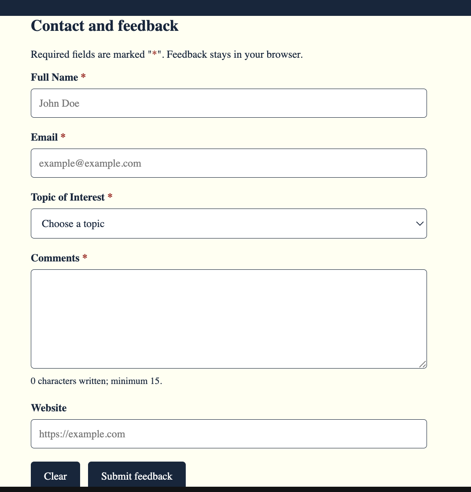
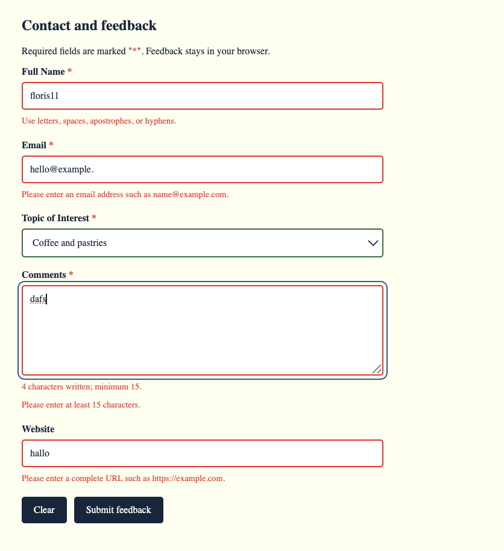
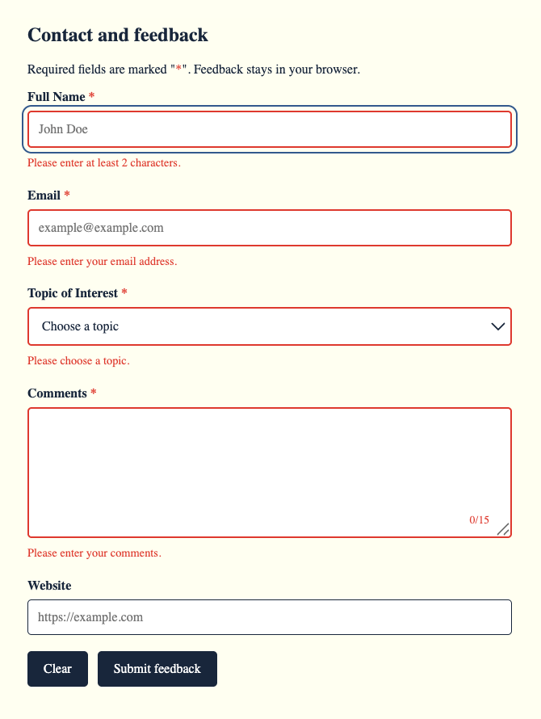
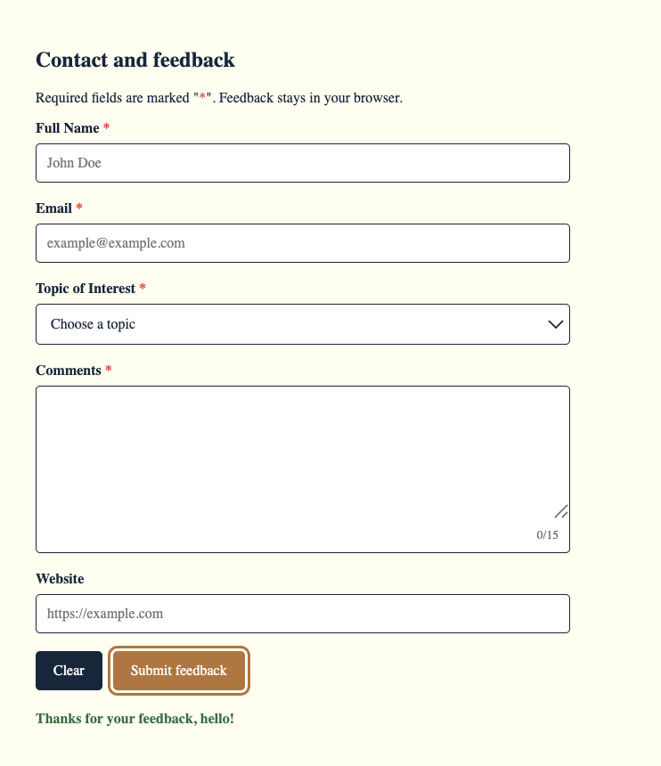
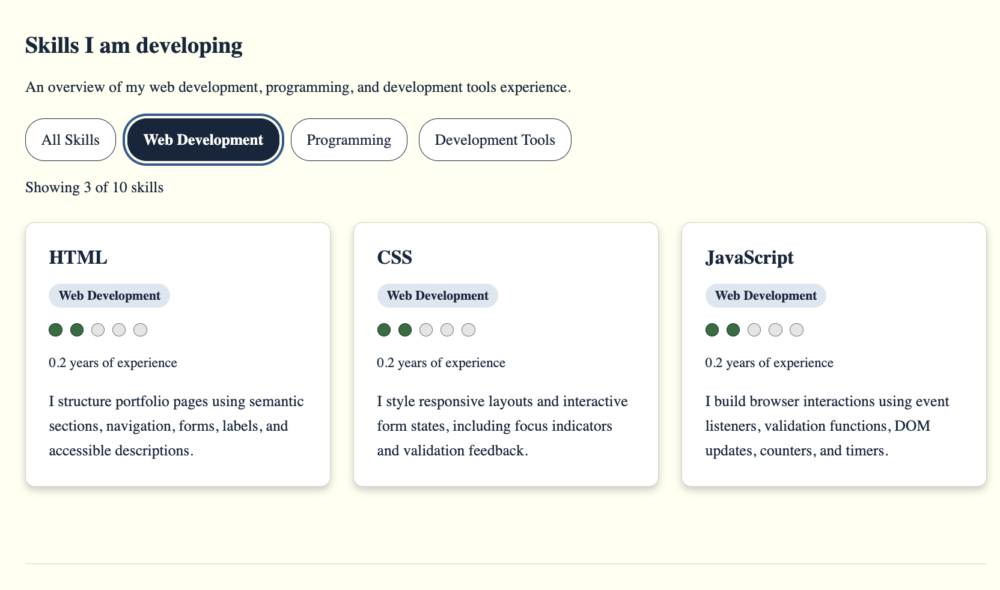
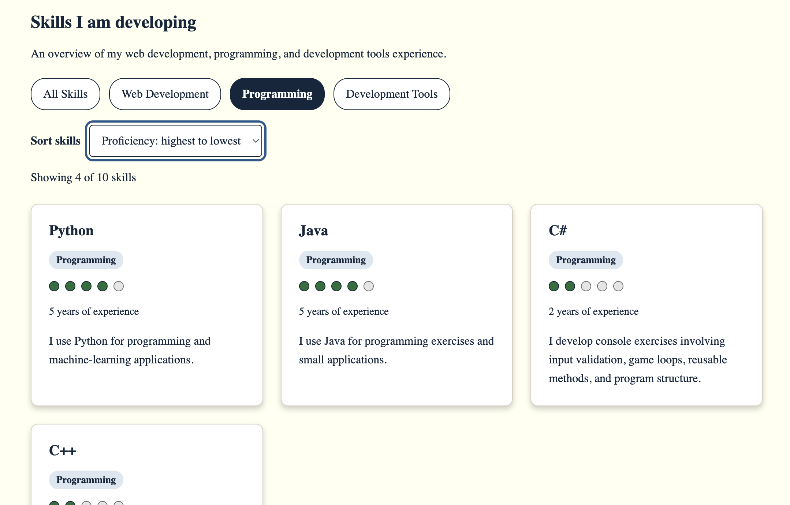
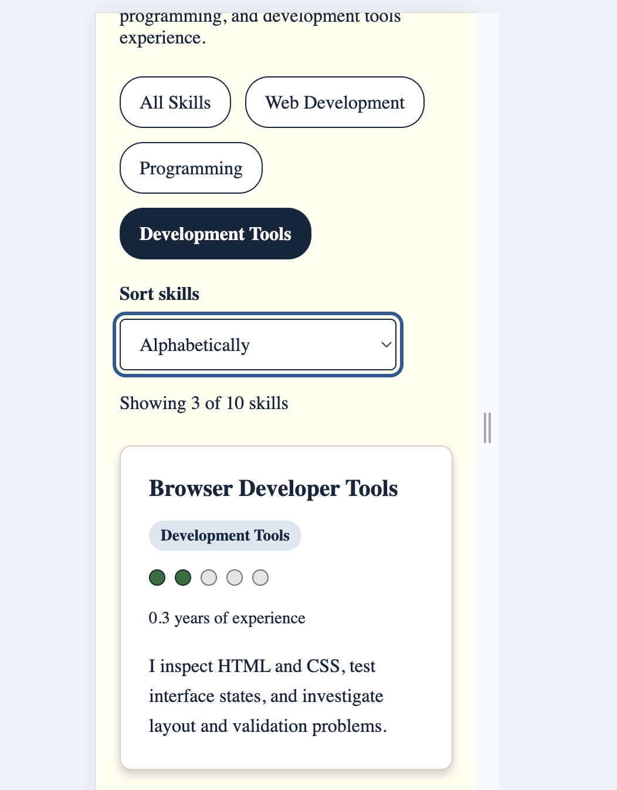

# Lab 2 Interactive Portfolio Report

Floris van der Staaij| DA558A | Target Grade 5

Repository: https://github.com/Fvdstaay/Javascript

Progress recorded on 29 October 2026

## Project information

I am extending my Lab 1 portfolio with vanilla JavaScript, targeting Grade 5. The current implementation contains the feedback form structure, supporting CSS, shared JavaScript helpers, and validation for all five fields, including a live comments counter. Submission handling validates all fields and displays personalized success feedback. Successful submission resets the form, and a timer is configured to remove the message after four seconds. The skills showcase now renders ten skills from data, supports category filtering, and displays a result count and empty-state feedback.

## Feedback form implementation

The feedback form is integrated into the Contact section of code/home.html. It contains required Full Name, Email, Topic of Interest, and Comments fields, plus an optional Website field. HTML attributes provide required-field constraints, minimum lengths, and email or URL types. Each control has a visible label and references its adjacent error paragraph through aria-describedby. The comments field also references its character counter.

The stylesheet provides neutral controls, visible focus, red invalid states, green valid states, and a red required-field marker. The form uses flexible layouts and full-width controls. These styles prepare the interface for validation; their presence alone does not demonstrate that validation works.

## Normal form appearance

*Figure 1: The feedback form before interaction. Required fields have red asterisks, controls have neutral borders, and the counter shows zero characters with a 15-character minimum. The Website field is optional. This image documents the initial appearance, not validation behavior.*

## Shared JavaScript helpers

code/feedback.js stores references to the form controls and feedback elements once using const. showFieldError() removes the valid class, adds the invalid class, sets aria-invalid to true, and writes a message using textContent. clearFieldError() removes the error class and aria-invalid attribute and empties the error message. showFieldValid() clears an error and adds the valid class. resetFieldState() clears the error and removes the valid class, returning the field to a neutral appearance without changing its value.

The helpers separate presentation updates from validation rules. They update field styling, accessible invalid states, and error messages without changing field values. The field validators call these helpers in response to blur, input, and change events.

## Field validation

Full Name, Email, Topic of Interest, and the optional Website field have dedicated validators. Text fields are checked when they lose focus and rechecked during editing after their first validation. Topic selection is checked on change and blur. Each validator returns a boolean and uses the shared helpers to update error text, styling, and accessible invalid state.

Name validation checks the trimmed value for at least two Unicode code points and allows international letters, combining marks, spaces, apostrophes, and hyphens while requiring at least one letter. Email and Website validation use the browser's typeMismatch property. Topic validation rejects the empty placeholder value. An empty Website field is accepted and returned to a neutral appearance because it is optional.

## Comments validation and counter

Comments are validated on input and blur. Every input event also updates the written character count and its red or green minimum-length feedback. Validation requires at least 15 non-whitespace Unicode code points. The counter uses the same rule and continues counting beyond the minimum. The counter and validator share one minimum-length constant.

*Figure 2: Field-validation feedback during editing. The name floris11 contains digits, the supplied email and Website values produce format errors, and the four-character comment is below the 15-character minimum. Coffee and pastries is selected and shown as valid. Errors include written explanations. This captures field feedback, rather than validation triggered by form submission.*

## Submission feedback

The submit handler prevents navigation, runs all five validators, and updates the counter. If any field is invalid, it focuses the first invalid control. Otherwise, it inserts a personalized success message using textContent. Browser validation popups are disabled through JavaScript so the handler can display all field errors together, while the validators still read browser validity properties.

*Figure 3: Submitting an empty form shows written errors for Full Name, Email, Topic, and Comments. Focus returns to Full Name. The empty optional Website field remains neutral.*

*Figure 4: After successful submission, the personalized message “Thanks for your feedback, hello!” remains visible while the fields are cleared, the topic placeholder is restored, validation borders return to neutral, and the counter returns to grey 0/15.*

## Reset and message lifecycle

Successful submission captures the name before calling feedbackForm.reset(). The reset event clears field errors, validation classes, aria-invalid attributes, the counter state, and any existing success message. The browser restores the field values. The submit handler then displays the personalized message and schedules its removal after four seconds. Clear uses the same reset event. A stored timer reference allows pending message removal to be cancelled before another submission or reset. Figure 4 shows the reset appearance; the four-second duration requires a separate timed interaction check.

## Skills data and rendering

The skills array in `code/skills.js` contains ten objects across Web Development, Programming, and Development Tools. Each object has a unique numeric `id`, a `name`, a `category`, a proficiency rating from 1 to 5, nonnegative `yearsExperience`, and a `description`. These objects are the source of the displayed content rather than manually written HTML cards.

`renderSkills()` receives an array and creates an article for each skill, including a heading, category badge, five proficiency dots, experience, and description. It assembles the cards in a document fragment and replaces the container's children, so repeated rendering does not duplicate cards. The dot group exposes the skill name and rating through an accessible label; individual dots are decorative. CSS lays out the cards in a responsive grid.

## Category filtering and result feedback

Each filter button stores its category in `data-category`. Clicking a button updates `activeCategory`, synchronizes the active class and `aria-pressed` on all buttons, and calls `updateSkills()`. That function uses `filter()` to create a derived array, passes it to the renderer, and updates the status text to “Showing X of Y skills”. The original array is not modified. Native buttons support keyboard activation without separate key handlers.

The All Skills option needs an explicit condition: `activeCategory === "all" || skill.category === activeCategory`. Initializing the state to the string `"all"` does not give it special filtering behavior. Without the first condition, no category matches and the result is empty. This was an implementation issue discussed and corrected while developing filtering.

When the supplied array is empty, the renderer replaces the cards with “No skills in this category”. The total count is derived from the source array, while the visible count comes from the filtered array. Figure 5 shows the filtered desktop layout and displayed result count. Figure 7 additionally documents the narrow layout. Keyboard operation was confirmed in the browser on 29 October 2026.

*Figure 5: Selecting Web Development displays HTML, CSS, and JavaScript and updates the counter to “Showing 3 of 10 skills”. The active button has distinct styling and a visible focus outline. Each card shows its category, proficiency dots, experience, and description. This screenshot documents category filtering before sorting is added.*

## Combined filtering and sorting

`updateSkills()` first filters the source array and then sorts the resulting array according to the selector before rendering the cards and updating the count. Numeric comparison functions support highest-first and lowest-first proficiency and experience. Because `filter()` returns a new array, sorting does not change the original data order. The Original order option skips sorting. Changing the category uses the currently selected sort, and changing the sort retains the current category.

*Figure 6: Programming is selected together with “Proficiency: highest to lowest”, and the counter shows “Showing 4 of 10 skills”. Python and Java, each rated four out of five, appear before C#, rated two out of five. The fourth result, C++, begins below the first row and is partially visible in this capture.*

The alphabetical option now uses `name-asc`, matching its JavaScript case and the `localeCompare()` comparison. Figure 6 provides browser evidence for combined category filtering and descending proficiency.

## Filter and sort verification

On 29 October 2026, an automated code-level check executed the actual `skills.js` in Node with a lightweight simulated DOM and controls derived from the current HTML. All 24 category and sort combinations passed. Each combination was checked for card membership, ordering, stable ordering for equal values, result count, selected-button styling, `aria-pressed`, five-dot ratings, and unchanged source data. A second pass changed categories under each selected sort and verified that the sort was preserved. Empty-state feedback also passed.

| Category | Original | Proficiency descending | Proficiency ascending | Experience descending | Experience ascending | Name A to Z |
|---|---|---|---|---|---|---|
| All Skills | Pass | Pass | Pass | Pass | Pass | Pass |
| Web Development | Pass | Pass | Pass | Pass | Pass | Pass |
| Programming | Pass | Pass | Pass | Pass | Pass | Pass |
| Development Tools | Pass | Pass | Pass | Pass | Pass | Pass |

These checks verify JavaScript behavior in a simulated DOM. They do not verify real-browser rendering, native keyboard behavior, screen-reader announcements, responsive layout, or the browser console. Those require separate browser checks.

## Responsive layout and motion preferences

*Figure 7: In the supplied narrow-viewport capture, the category buttons wrap across rows and the sort control appears beneath them. Development Tools is selected with alphabetical sorting, the counter shows three of ten results, and the first card is Browser Developer Tools. The visible card text wraps within its boundaries. The exact viewport width was not recorded.*

The stylesheet defines a short card entrance animation and filter color transitions. A `prefers-reduced-motion: reduce` query disables the card animation and the form and filter transitions. The screenshot documents the narrow layout. On 29 October 2026, I confirmed that reduced-motion behavior works in the browser. On the same date, I also confirmed that the skills controls work using the keyboard.

## Git development

I developed the feedback form in separate steps: portfolio structure fixes (3b1405a), form markup (8fec860), and interaction styling (a097ae7). I then added documented feedback helpers (66bb915), field validation (4945431), and the live comments counter (67c3b78). Keeping these changes separate makes it possible to follow how the form progressed from HTML structure to interactive feedback.

Submission handling and the inset counter were added in 1100171. During testing, long comments revealed that the counter could cover text, and Clear left feedback behind. Commit d496c3f completed the reset and timer behavior and moved the counter into a separate footer to prevent overlap. This sequence records a concrete refinement prompted by testing rather than only the finished interface. The report began in its own commit, 325cf64, so documentation developed alongside the implementation.

For the skills showcase, I first defined the data (c9ba3b0), replaced the static table with containers (7f1d533), and added rendering from the array (3d2da3f). I then added category, proficiency, and experience information (118c1fa) before styling the responsive cards and replacing meters with accessible dot ratings (80e2da1). Separating data, rendering, and presentation made each stage easier to review. Category controls were added in d08f215, filtering and synchronized button state in 392014e, and result counts with empty-state feedback in e1af1de. The sort selector was added in c9a54ad and sorting logic in 7c2ffce, including both numeric directions. The alphabetical option-value mismatch was subsequently corrected in the working files.
